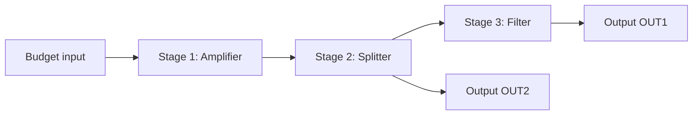
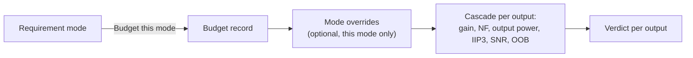

# RF Budget

The RF Budget predicts what a receiver chain will do before you wire it. Open it from **View > RF Budget**. The View item toggles the dockable panel, its visibility persists between runs, and the panel opens in the [Utility Space](utility-views.md) group beside the main window.

You describe the chain as a horizontal signal flow — the budget input on the left, one compact block per stage (amplifier, attenuator, filter, coax, equalizer, splitter, or RF switch), the outputs on the right — give one or more [requirement modes](receiver-requirements.md) a budget record, and the budget predicts each mode's gain, noise figure, output power, IIP3, SNR, and out-of-band suppression at every output, with a verdict per output.

A budget **Pass** is a prediction, not a verification: the budget evaluates the component models without touching the live circuit. Confirm on the real circuit with the [Network Analyzer](network-analyzer.md) or a [power](power-meter.md) reading.

## Build the signal chain

The **Signal chain** strip reads like the wiring it describes: a **Budget input** block on the left, one block per stage flowing left to right in chain order, and an **Outputs** block closing the strip on the right. When the dock is narrower than the chain, the strip scrolls horizontally instead of reflowing, so the left-to-right reading survives any dock width.

- **Add Stage** appends a block, named `Stage 1`, `Stage 2`, and so on. The first stage is fed from the **Budget input** automatically.
- Each block's **Type** list offers **Amplifier, Attenuator, IdealFilter, Coax Cable, Equalizer, Splitter, SPDT Switch, SPDT Switch (2:1), Digital Step Attenuator**.
- **Source** picks **Idealized** or **Library**. An idealized stage edits its numbers through the **Params...** editor — each field starts at its default and an **Override** button sets it. A library stage instead picks a part from the [Component Library](component-library.md).
- Each input port has its own feed combo right in the block: **Unfed** (drawn as a warning, since an unfed stage never reaches the cascade), the **Budget input**, or another stage's output. A splitter feeds all of its outputs; a switch follows its active throw.
- **Rename...** and **Remove** act on the block. Removing a stage unfeds whatever it drove.

The budget needs one stage fed from the budget input, every stage reachable from it, and no loops. Mixer stages are not supported. Up to 32 stages fit.

## Add outputs

The **Outputs** block on the right names where the cascade ends: **Add Output** appends `OUT1`, `OUT2`, and so on, each picking a stage and one of its ports. Every reached output gets its own cascade and verdict. Up to 8 outputs fit, and each output port can feed at most one thing.

A budget might be wired like this — one chain from the budget input, a splitter feeding both a stage and a second output, and a cascade at every reached output:

**Points** (2 to 401, default 201) sets the shared frequency grid, which runs over the selected mode's band.

## Budget a mode

The **Mode overrides** section lists every requirement mode, marking budgeted ones `(budgeted)`.

From a mode to its predicted verdicts:

- **Budget this mode** gives the selected mode a budget record, so it is predicted even with no overrides. Without a record the mode is not predicted at all.
- **Clear budget record** removes the record — after you remove that mode's overrides first.
- The overrides table pins one setting of one stage for this mode only, for example a switch's active throw. Each override starts from the stage's current value and can be edited or removed in its row.

## Read the cascade

The **Cascade** section evaluates the selected mode:

- The **verdict strip** shows one pill per metric — **Overall, Gain, Noise figure, Output power, IIP3, SNR, OOB** — for the selected output.
- The **Sweep** plots total gain and total noise figure across the band with the mode's requirement limits drawn as reference lines.
- **Worst case over the band** tabulates each stage's gain and noise figure, the cumulative gain and noise figure, level, and P1dB headroom as in-band minimum to maximum.
- **At one frequency** slides a point along the grid and tabulates per-stage gain, NF, OIP3, cumulative Friis and IIP3, level, NF share, and headroom at that exact frequency.

A stage or metric that cannot be evaluated shows its reason instead of a number — for example a chain with no nonlinear stage reports that IIP3 cannot be measured and reads **Incomplete**.

Output power and SNR are predicted from the mode's **Input level**: output power is input level plus cumulative gain, and SNR is input level minus thermal noise in the **SNR bandwidth** minus the cumulative noise figure. A mode without an input level reads **Incomplete** for both. Out-of-band suppression is judged at each of the mode's configured points on the budget's grid.
