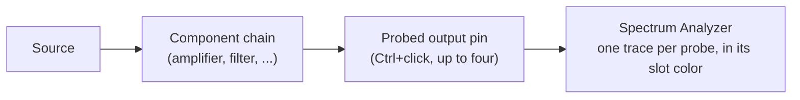

# Spectrum Analyzer

The Spectrum Analyzer plots the live spectrum of every probed node. Open it from **View > Spectrum Analyzer**. The panel is a dockable window; the View item toggles it, and its visibility persists between runs.

The signal travels from a source through the component chain, a probe picks the point to watch, and the analyzer plots what arrives there:

## Probe a node

- **Ctrl+click an output pin** to probe it. The analyzer plots that node's signal with a trace in the probe's color.
- **Ctrl+click a node body** to probe that node's first output. The click also adds the node to the selection.
- **Shift+click** a probed pin to remove the probe.
- Probing a connected **input pin** works too: the trace resolves to the upstream output.
- A collapsed subcircuit block probes its first output boundary pin.

The pin tooltip shows the gesture. Up to **four probes** can be active, in slot colors teal, orange, purple, and blue; a fifth probe, or a duplicate probe on the same pin, is silently refused. The panel's `Probes:` line lists the probes with their node labels, for example `[0] Amp1 OUT`.

Probes are saved with the project, count as an unsaved change, and are covered by [undo](undo-redo.md).

## Show and hide traces

Click a trace's **legend entry** to hide or show it. Hidden traces are excluded from the Peak, marker, and average-noise readouts but keep advancing their own hold and average history; showing the trace again resumes from where it left off. Adding or removing any probe resets all traces to visible. If every trace is hidden, the panel says so.

## Set the view

Four fields frame the plot:

| Control | Meaning |
| --- | --- |
| **Start Frequency (MHz)** / **Stop Frequency (MHz)** | X-axis span, within −20 GHz to +20 GHz |
| **Ref (dBm)** | Top of the Y axis |
| **Min level (dBm)** | Bottom of the Y axis, within −174 to +10 dBm |

**Drag** with the left mouse across the plot to select a frequency band; on release the span fields snap to it. **Reset Zoom** restores the full default span, −20 to +20 GHz.

## Resolution and video bandwidth

| Control | Range | Default | Effect |
| --- | --- | --- | --- |
| **RBW (kHz)** | 1 kHz – 100 MHz | 50 MHz | Noise power integrates over this bandwidth. A narrower RBW lowers the displayed noise floor, even below the source bin spacing; tone peaks stay unchanged. |
| **VBW (kHz)** | 1 kHz – 100 MHz | 25 MHz | Smoothing window across the displayed trace. A wider VBW smooths the noise floor; tone peaks are not reduced. |
| **Avg Count** | 2 – 100 | 10 | Video-average length, active only in **Video Avg** trace mode. Larger counts average over more frames. |

## Trace mode

The **Trace Mode** list picks how each trace is drawn:

- **Clear/Write** — the live trace, replaced every frame.
- **Max Hold** — each trace keeps the per-bin maximum on its own grid.
- **Min Hold** — each trace keeps the per-bin minimum.
- **Video Avg** — an exponential average of the displayed trace over the last **Avg Count** frames.

Changing the trace mode, RBW, VBW, or Avg Count clears all hold and average history. In Max Hold or Min Hold, a **Reset Hold** button clears it directly. Changing the frequency span does not clear history.

## Readouts

- **Peak** shows the strongest bin of the combined visible traces, with its frequency and power. In Max Hold or Min Hold it reads the held value on the same sum as the plot; in Clear/Write and Video Avg it reads the current frame.
- **Average noise level** is the mean per-bin noise across the visible traces with tones excluded.
- **Marker** — tick **Enable Marker** to place it mid-span, then **Snap to Peak** to jump to the strongest of up to eight local maxima and **Next Peak** to cycle through them. The marker is not draggable: move it with the peak buttons, or disable and re-enable it to return to mid-span.

Peak, marker, and average-noise readouts are jitter-free; only the drawn noise floor carries a small cosmetic jitter.

Each probe is plotted on its own frequency grid. The readouts combine the visible traces on a shared axis spanning all of them at their coarsest bin spacing, so traces from different grids are never summed bin by bin.

The PFB Channelizer's per-channel output draws in light sky blue regardless of slot, and its full-band trace carries an **Active Ch** segment over the active channel.

## Nothing probed

With no probes the panel reads `No node probed`. With probes but no signal it names the problem, for example `Unable to display spectrum (no frequency grid).`
