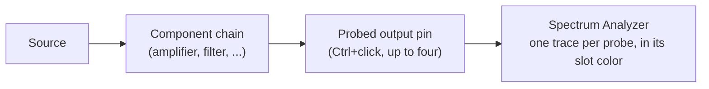

# Spectrum Analyzer

The Spectrum Analyzer plots the live spectrum of every probed node. Open it from **View > Spectrum Analyzer**. The panel is a dockable window; the View item toggles it, and its visibility persists between runs.

The signal travels from a source through the component chain, a probe picks the point to watch, and the analyzer plots what arrives there:

## Probe a node

- **Ctrl+click an output pin** to probe it. The analyzer plots that node's signal with a trace in the probe's color.
- **Ctrl+click a node body** to probe that node's first output. The click also adds the node to the selection.
- **Shift+click** a probed pin to remove the probe.
- Probing a connected **input pin** works too: the trace resolves to the upstream output.
- A collapsed subcircuit block probes its first output boundary pin.

The pin tooltip shows the gesture. Up to **four probes** can be active, in slot colors teal, orange, purple, and blue; a fifth probe, or a duplicate probe on the same pin, is silently refused. The panel's `Probes:` line lists the probes with their node labels, for example `[0] Amp1 OUT`.

Probes are saved with the project, count as an unsaved change, and are covered by [undo](undo-redo.md).

## Show and hide traces

Click a trace's **legend entry** to hide or show it. Hidden traces are excluded from the Peak, marker, and average-noise readouts but keep advancing their own hold and average history; showing the trace again resumes from where it left off. Adding or removing any probe resets all traces to visible. If every trace is hidden, the panel says so.

## Set the view

Four fields frame the plot:

| Control | Meaning |
| --- | --- |
| **Start Frequency (MHz)** / **Stop Frequency (MHz)** | X-axis span, within −20 GHz to +20 GHz |
| **Ref (dBm)** | Top of the Y axis |
| **Min level (dBm)** | Bottom of the Y axis, within −174 to +10 dBm |

**Drag** with the left mouse across the plot to select a frequency band; on release the span fields snap to it. **Reset Zoom** restores the full default span, −20 to +20 GHz.

## Single-sided spectrum

The **Spectrum** list, beside **Reset Zoom** below the plot, picks how a real-domain trace is drawn:

- **Double-sided** (the default) shows a real signal's conjugate-symmetric image: a real tone appears at both `+f` and `-f`, each at half its power.
- **Single-sided** folds the negative-frequency half onto the positive half and starts the axis at 0 Hz. A real tone reads its full level at `+f`.

Worked example: a real tone of −3 dBm at 100 MHz.

| View | Reading at +100 MHz | Reading at −100 MHz |
| --- | --- | --- |
| Double-sided | −6.01 dBm | −6.01 dBm |
| Single-sided | −3.00 dBm | not shown (the axis starts at 0 Hz) |

Folding follows the physics of a real signal:

- Two real tones at the same frequency add as phasors. Two equal tones in phase read +6 dB over one tone (+3.02 dBm for two −3 dBm tones, against 0.01 dBm on each side when double-sided). Two equal tones in opposite phase cancel.
- Independent noise adds as power, so a flat real noise floor reads about +3 dB per bin.
- A tone within one bin of 0 Hz folds into the 0 Hz bin at its full level. Its mirror is the same tone, so it is not counted twice.
- A real trace on a grid with no bin at or above 0 Hz plots nothing.
- A span that ends at or below 0 Hz has no folded half inside it. The panel warns in amber, and the plot keeps the span you set rather than drawing an inverted axis. Raise **Stop** above 0 Hz to see the folded trace.
- A marker parked on a negative frequency moves to its folded image when **Single-sided** is selected: a marker at −100 MHz moves to +100 MHz, the same tone. Switching back to Double-sided does not move it. Every change of the **Spectrum** mode also clears the markers' cached peak lists, so **Next Peak** starts from the new trace.

Complex-baseband traces (ADC and PFB outputs) have no negative-frequency image, so they are drawn unchanged. The panel says so when a probed trace is complex-baseband, and the axis keeps its negative half.

Peak, the markers, the peak table, the harmonic and IM3 measurements, and the average noise level read the folded trace. Changing the **Spectrum** mode clears the hold and average history, like the RBW and VBW settings. The mode is view state: it is not saved with the project and starts as Double-sided each run. The agent API's `measure_port` tool reports stored tone power and noise, not this view, so its output is the same in both modes; its "3.01 dB above the displayed peak" note refers to the double-sided display.

## Resolution and video bandwidth

| Control | Range | Default | Effect |
| --- | --- | --- | --- |
| **RBW (kHz)** | 1 kHz – 100 MHz | 50 MHz | Noise power integrates over this bandwidth. A narrower RBW lowers the displayed noise floor, even below the source bin spacing; tone peaks stay unchanged. |
| **VBW (kHz)** | 1 kHz – 100 MHz | 25 MHz | Smoothing window across the displayed trace. A wider VBW smooths the noise floor; tone peaks are not reduced. |
| **Avg Count** | 2 – 100 | 10 | Video-average length, active only in **Video Avg** trace mode. Larger counts average over more frames. |

## Trace mode

The **Trace Mode** list picks how each trace is drawn:

- **Clear/Write** — the live trace, replaced every frame.
- **Max Hold** — each trace keeps the per-bin maximum on its own grid.
- **Min Hold** — each trace keeps the per-bin minimum.
- **Video Avg** — an exponential average of the displayed trace over the last **Avg Count** frames.

Changing the trace mode, RBW, VBW, Avg Count, or **Spectrum** mode clears all hold and average history. In Max Hold or Min Hold, a **Reset Hold** button clears it directly. Changing the frequency span does not clear history.

## Measure on a probe

The **Measure on** list picks which trace the measurement readouts follow:

- **All visible** (the default) keeps the historic combined readout: every visible trace, sampled onto one shared axis.
- **`[n] <label>`** scopes **Peak**, **Average noise level**, the markers, **Snap to Peak**, **Next Peak**, the harmonic measurement, and the IM3 measurement to that one probe's own trace and frequency grid. The plot still draws every probe; only the measurements change.

The chosen probe stays selected if its trace is hidden or its probe is removed. While that happens the panel reads `Measure on: All visible traces (probe [n] … hidden)` or `… (probe … removed)` and measures the visible traces, so it never silently measures a different trace. Showing the probe again, or probing it again, resumes measuring it; choosing **All visible** clears the stored selection. The selection is view state: it is not saved with the project and does not mark it dirty.

## Readouts

- **Peak** shows the strongest bin of the measurement source selected by **Measure on** (all visible traces, or one probe's trace), with its frequency and power. In Max Hold or Min Hold it reads the held value on the same sum as the plot; in Clear/Write and Video Avg it reads the current frame.
- **Average noise level** is the mean per-bin noise across the measurement source with tones excluded.

Peak, marker, average-noise, harmonic, and IM3 readouts are jitter-free; only the drawn noise floor carries a small cosmetic jitter.

Each probe is plotted on its own frequency grid. With **Measure on: All visible**, the readouts combine the visible traces on a shared axis spanning all of them at their coarsest bin spacing, so traces from different grids are never summed bin by bin. With one probe selected, the readouts use that probe's trace on its own grid.

The PFB Channelizer's per-channel output draws in light sky blue regardless of slot, and its full-band trace carries an **Active Ch** segment over the active channel.

## Markers

The analyzer has four markers, **M1** to **M4**, each in its own color on the trace. Tick a marker's checkbox to place it mid-span. Markers are display cursors: they never enter the project, do not count as unsaved changes, and are not undone. Like the panel's visibility, they persist between runs on Windows and start disabled elsewhere.

- **Drag** a marker's vertical line (or its dot) left or right to move it along the trace. The readout follows live, and the marker settles on the nearest displayed bin when you release it.
- **Ctrl+click** the plot to place the selected marker at that frequency.
- **Marker** picks which marker the peak buttons act on. Clicking a marker line, its dot, or its line in the readout strip also selects it.
- **Snap to Peak** moves the selected marker to the strongest of up to eight local maxima. **Next Peak** cycles that marker through the same list. Changing the **Measure on** source clears every marker's cached peak list, so Next Peak starts from the newly selected trace.
- **Delta (vs M1)** switches the selected marker to a relative readout: frequency offset and dB offset from M1. M1 is the reference marker and always reads absolute; while M1 is off, a delta marker shows that the reference is unavailable.
- The compact readout strip under the plot shows every enabled marker's frequency and amplitude, or its delta values. Clicking a strip line selects that marker.
- **Marker Table** shows or hides a table of every enabled marker with absolute frequency and amplitude and the delta columns.

Markers read the same jitter-free values as **Peak** on the current **Measure on** source: they follow its trace visibility and its Max Hold and Min Hold values, and a marker at a given frequency names the same bin the Peak readout uses. As for Peak, Clear/Write and Video Avg read the current frame.

## Peak table

Tick **Peak Table** beside the marker controls to show or hide a table of the up to five strongest local maxima of the **Measure on** source. Rows are sorted by descending amplitude: row 1 is the strongest peak and anchors the delta columns, so it reads `+0.000 MHz` and `+0.00 dB`.

| Column | Meaning |
| --- | --- |
| # | Rank, strongest first |
| MHz | Peak frequency |
| dBm | Peak amplitude |
| df MHz | Frequency offset from the strongest peak |
| dAmp dB | Amplitude offset from the strongest peak |

- Click a row to select it (highlighted) and move the selected marker (**Marker**, M1 to M4) onto that peak. The marker is switched on if it was off.
- **Prev Row** and **Next Row** step the selection, wrapping at either end, and move the marker the same way.
- The table reads the same jitter-free trace as **Peak** and the markers, so it follows the **Measure on** source, trace visibility, and Max Hold, Min Hold, and Video Avg. Clear/Write and Video Avg read the current frame.
- The table is view state: it does not enter the project, does not count as an unsaved change, and is not undone. Its show/hide state persists between runs on Windows, like the markers.

## Harmonics

Tick **Harmonics** beside **Peak Table** to measure the fundamental and its 2nd and 3rd harmonics on the **Measure on** source.

- The fundamental is the strongest tone-like peak: a local maximum at least 6 dB clear of the trace's median level (its noise floor) that also dips by that much on both sides within one RBW (at least one bin). A raised noise band, flat or rippled, has no such dip, so it reads `No clear fundamental` instead of naming one.
- The search follows the trace: on a one-sided complex-baseband trace (an ADC or PFB output) a negative-frequency tone is measured at its own frequency and its harmonics are at negative multiples. On a mirrored real-domain trace the positive image is preferred.
- Tick **Use marker as fundamental** to take the selected marker's frequency as the fundamental instead of the strongest tone. The box is disabled while the selected marker is off, and the fundamental line says whether it came from the marker or the strongest tone. A marker outside the current span reads `No clear fundamental: the marker is outside the current span`, and one at 0 Hz reads that it has to be placed on a tone.
- Each harmonic is searched within one resolution bandwidth (RBW) of twice and three times the fundamental, on the same jitter-free trace as **Peak** and the markers, so it follows **Measure on**, trace visibility, and the Max Hold, Min Hold, and Video Avg modes.
- A harmonic outside the swept span reads `outside span`; an RBW or bin spacing as wide as the fundamental frequency, which blurs adjacent harmonic orders together, reads `RBW too wide` (the RBW) or `grid too coarse` (the spacing); a harmonic with no peak clear of the noise floor reads `not found`. None of these are guessed.

| Column | Meaning |
| --- | --- |
| Harmonic | 2nd or 3rd |
| MHz | Measured harmonic frequency |
| dBm | Harmonic level on the readout trace |
| dBc | Harmonic level minus the fundamental level |

The fundamental line names the fundamental's frequency and level. Levels are the displayed trace values, the same as **Peak** and the markers. The block is view state: it does not enter the project, does not count as an unsaved change, and is not undone, and its show/hide state persists between runs on Windows.

## IM3

Tick **IM3** beside **Harmonics** to measure the third-order intermodulation products of the two fundamental tones on the **Measure on** source.

- The two fundamentals are the strongest two tone-like peaks: local maxima at least 6 dB clear of the trace's median level (its noise floor) that also dip by that much on both sides within one RBW (at least one bin). Fewer than two such peaks reads `Need two tones` instead of naming one.
- On a real-domain trace every tone is mirrored at `+-f`; the positive image names the tone, so the pair is two tones, not a tone and its own mirror. On a one-sided complex-baseband trace (an ADC or PFB output) both tones may be at negative frequencies and are measured at their own frequencies.
- The pair is ordered by frequency: f1 is the lower tone and f2 the higher. Two equally strong tones therefore resolve deterministically, lower frequency first.
- Tick **Use M1 and M2 as tones** to take the frequencies of **M1** and **M2** as the fundamentals instead of the auto-detected pair. The box is disabled unless both markers are on. A marker outside the current span reads `a marker is outside the current span`; a pair at the same frequency, or at 0 Hz, reads `Need two tones`. The two markers are ordered by frequency too, so it does not matter which one sits on the lower tone.
- The products are at `2*f1-f2` (low side, nearest f1) and `2*f2-f1` (high side, nearest f2), each searched within one resolution bandwidth (RBW) of its expected frequency on the same jitter-free trace as **Peak** and the markers. They therefore follow **Measure on**, trace visibility, and the Max Hold, Min Hold, and Video Avg modes.
- Each product reports its frequency, level, and dBc relative to the fundamental it is nearest. **TOI (est.)** is a spectrum-derived output-intercept estimate, `(P1 + P2 - dBc) / 2` averaged over the measured products. It is an estimate from the displayed levels, not a substitute for the Receiver Requirements IIP3 test.
- A product outside the swept span reads `outside span`; one the RBW or the bin spacing cannot separate from its fundamental reads `RBW too wide` (the RBW) or `grid too coarse` (the spacing); one with no peak clear of the noise floor reads `not found`. None of these are guessed.

| Column | Meaning |
| --- | --- |
| Product | `2f1-f2` or `2f2-f1` |
| MHz | Measured product frequency |
| dBm | Product level on the readout trace |
| dBc | Product level minus its nearest fundamental's level |

The tone line names both fundamentals' frequencies and levels, or says why two tones are missing. The block is view state: it does not enter the project, does not count as an unsaved change, and is not undone, and its show/hide state persists between runs on Windows.

## Nothing probed

With no probes the panel reads `No node probed`. With probes but no signal it names the problem, for example `Unable to display spectrum (no frequency grid).`
