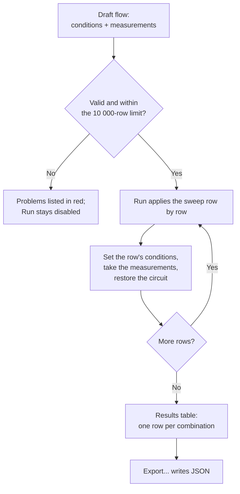

# Test Flows

A test flow sweeps a live circuit through parameter values and captures measurements at every step. Open **View > Test Flow** to toggle the panel. View items toggle, and panel visibility persists between runs.

A flow is a small JSON file you can author in the panel, save, and reload later, or hand-edit outside the app. **Export...** writes the captured results as JSON.

## Author a flow

The **Authoring** section builds the sweep:

1. Click **New from Circuit** to scaffold a draft. It picks the first component that has an output port, adds one `power_dBm` measurement on its port 0, and pre-fills the condition form with the first component that exposes a numeric parameter and that parameter's current value. The previous in-tool draft, if any, is replaced.
2. Pick a **Component** from the list. Each entry shows the component's id and type, for example `100 Amplifier`.
3. Pick a **Key** from the list. The list shows the component's real parameter keys — the saved key names, not the inspector labels — each with its type and current value, for example `atten_dB  (number = -3)`. Non-numeric keys are listed but disabled. Picking a key seeds the values field with its current value, so the sweep starts from where the circuit is now.
4. Type the sweep **Values**, for example `-30, -20, -10`. Separate numbers with commas, semicolons, or spaces.
5. Click **Add condition**. The condition appears in the table with its component, path, values, and count. A row's **Edit** button loads it back into the form (**Update condition** replaces it, **Cancel edit** leaves it alone); **Remove** deletes it.

A path uses dots and zero-based array indices, such as `gain_dB` or `tones[0].power_dBm`. Indices must not have leading zeros: `tones[01]` is refused. One component can sweep a key only once — the panel refuses a second condition on the same component and path and asks you to edit the existing one.

## Author a measurement

The **Author a measurement** form adds what the flow records at every row:

1. Pick a **Measure component**. Components without an output port are listed disabled.
2. Pick an output **Port** and a **Metric**:

| Metric | Reads | Unit |
| --- | --- | --- |
| `power_dBm` | Total power at the port, the same reading as the Power Meter | dBm |
| `peak_power_dBm` | Strongest tone's power | dBm |
| `peak_freq_Hz` | Strongest tone's frequency | Hz |
| `noise_floor_dBm_per_Hz` | Mean noise density | dBm/Hz |

3. Click **Add measurement**.

A metric reads `N/A` when the port's signal cannot be measured that way, for example a peak metric on a node with no tones.

## Run the flow

The panel previews the sweep before it runs: **Expected rows: N** counts every combination of all conditions' values, and every validation problem is listed in red above **Run**. **Run** stays disabled until the flow is valid and the row count is within the panel's 10 000-row limit.

**Run** applies the sweep row by row: each row sets the conditions, takes the measurements, then restores the circuit's parameters, links, and dirty flag exactly as they were before the next row. A clean run leaves the circuit untouched. On success the status reads `Flow completed: N row(s).`

A run walks the sweep like this, from draft to exported JSON:



If the circuit could not be restored, the panel latches: `Restore failed: <reason> — reload the circuit to run flows again.` Every later run is refused until the circuit is reloaded.

## Read the results

The **Results** table appears after a successful run. One row per sweep combination: the **Row** number, one column per condition (`100:tones[0].power_dBm = -30`), and one column per measurement (`101:0:power_dBm = 12.5 dBm`). The table scrolls instead of growing the window.

Click **Export...** to save the results as JSON. Each row lists the conditions it applied — the value the component actually took after normalization — and each metric's value, unit, and validity. Non-finite readings export as `null`.

## Save, reload, and open

- **Save Flow...** writes the flow as JSON (`JSON flow (*.json)`), then loads the saved file straight back so the panel and the file agree. A flow needs at least one measurement before it can be saved.
- **Open Flow...** loads a saved flow. Loading a file discards in-tool edits; the status line says so.
- **Reload** re-reads the selected file, so a hand edit outside the app is picked up without reopening the dialog.

A flow file is plain JSON:

```json
{
  "version": 1,
  "name": "amp power sweep",
  "conditions": [
    { "component": 100, "path": "tones[0].power_dBm", "values": [-30, -20, -10] }
  ],
  "measure": [
    { "component": 101, "port": 0, "metric": "power_dBm" }
  ]
}
```

Conditions are optional; `measure` must have at least one entry. The file is written atomically, so a failed save never truncates a hand-authored flow.

A flow refers to components by id. Ids are assigned when the project is saved, so a deletion or reorder in the circuit can shift them. Treat a saved flow as valid for the circuit it was authored on; if a flow's component or key no longer resolves, the offending row shows in red and the panel lists the component's sweepable keys.

Agents can run flows through the bridge; see [Agent (MCP)](agent-mcp.md).
